# SafeGuard Mobile

<p align="center">
  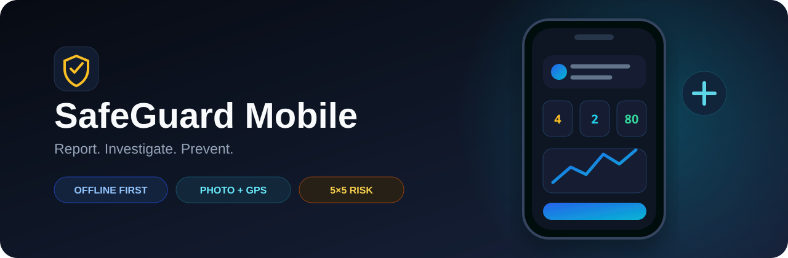
</p>

<p align="center">
  <a href="https://github.com/Abdullah6482/safeguard-mobile/actions/workflows/ci.yml"></a>
  
  
  
  <a href="LICENSE"></a>
</p>

SafeGuard Mobile is an offline-first HSE incident reporting and investigation application for field teams. Reporters can capture an event in minutes—even without connectivity—while investigators claim cases, assess four dimensions of impact, define corrective action, and forward a complete record for management review.

The companion [SafeGuard Web portal](https://github.com/Abdullah6482/safeguard-web) completes the lifecycle with manager decisions, analytics, and portfolio governance.

## Product preview

<p align="center"><em>Captured from the running Expo web build at a 390 × 844 mobile viewport.</em></p>

<table>
  <tr>
    <th>Secure sign in</th>
    <th>Reporter home</th>
    <th>Work context</th>
  </tr>
  <tr>
    <td>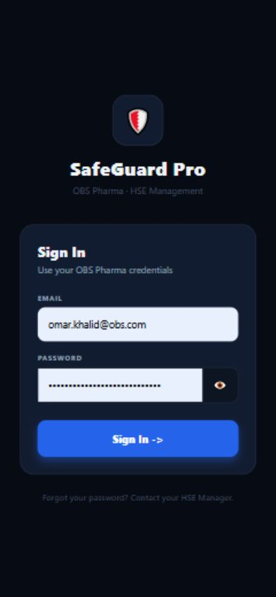</td>
    <td>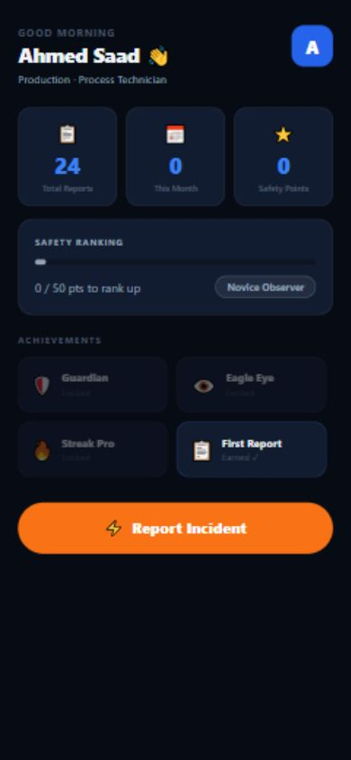</td>
    <td>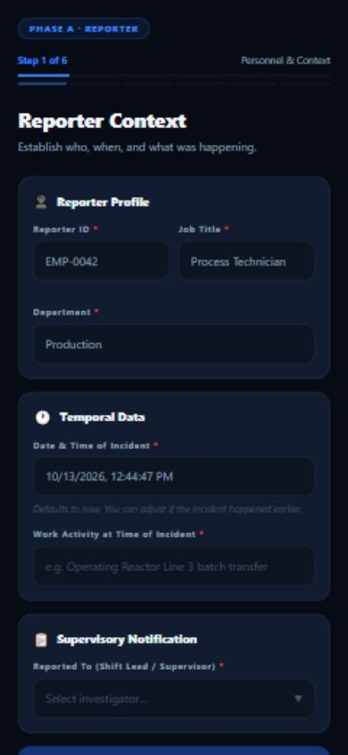</td>
  </tr>
  <tr>
    <th>Incident classification</th>
    <th>Incident details</th>
    <th>Initial risk matrix</th>
  </tr>
  <tr>
    <td>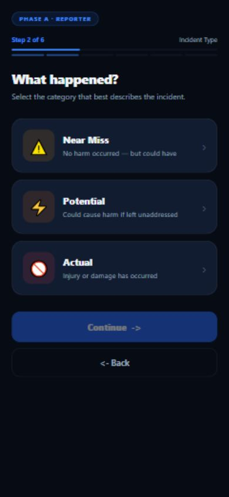</td>
    <td>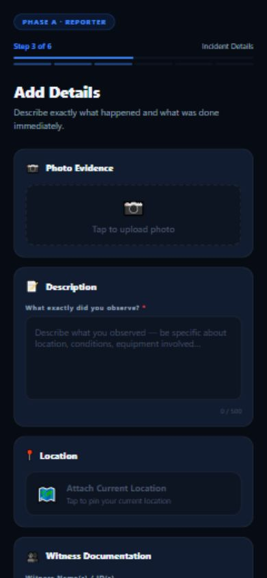</td>
    <td>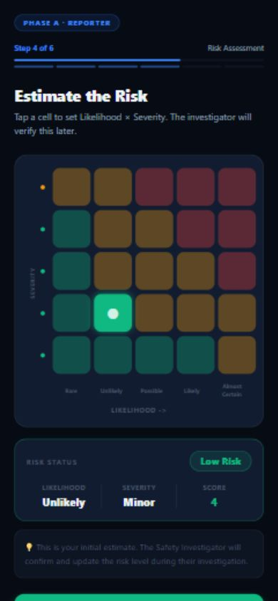</td>
  </tr>
  <tr>
    <th>Submission confirmation</th>
    <th>Investigator queue</th>
    <th>Investigation detail</th>
  </tr>
  <tr>
    <td>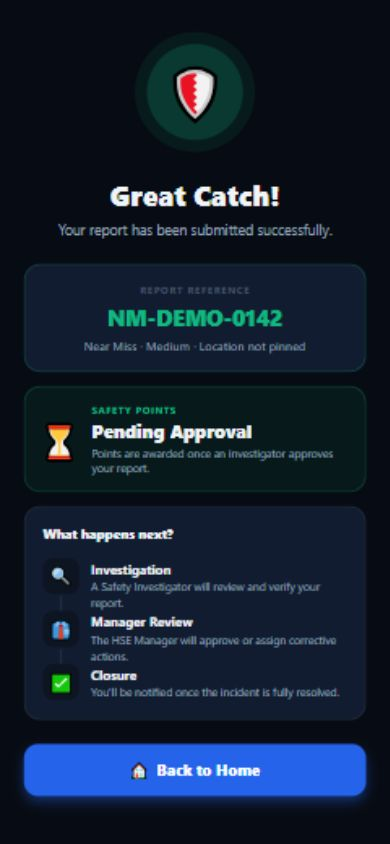</td>
    <td>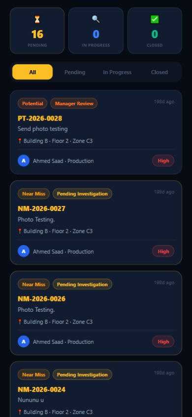</td>
    <td>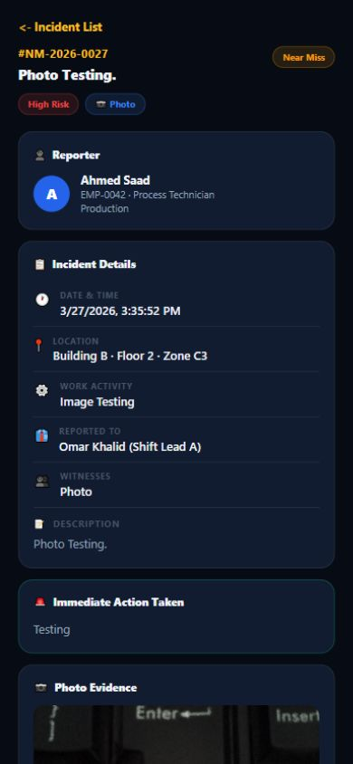</td>
  </tr>
  <tr>
    <th colspan="3">Manager handoff</th>
  </tr>
  <tr>
    <td colspan="3" align="center">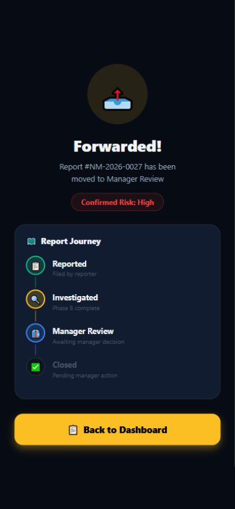</td>
  </tr>
</table>

The gallery uses demo records and shows the complete role-aware path from reporting through investigation handoff. See the [screenshot manifest](docs/screenshots/mobile/README.md) for the screen index.

## Two role-specific experiences

| Reporter | Investigator |
|---|---|
| Guided incident submission | Assigned and unassigned investigation queues |
| Camera or gallery evidence | Atomic incident claiming |
| GPS and reverse-geocoded location | Evidence and reporter-context review |
| 5×5 initial risk assessment | People, Asset, Environment, and Reputation scoring |
| Durable offline queue | Root-cause and CAPA documentation |
| Safety points and achievements | Audited handoff to manager review |

## Field workflow

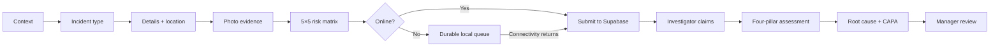

## Reliability by design

- Evidence is copied into application-owned storage before offline queuing.
- Every report receives a stable `client_submission_id` for idempotent retries.
- Pending work synchronizes at startup and whenever the app becomes active.
- Retryable failures use exponential backoff with jitter.
- Permanently invalid items are quarantined so one report cannot block the queue.
- Claiming and investigation submission run through atomic PostgreSQL functions.
- Safety points and audit records are written in the same transaction as investigation completion.

## Architecture

```text
Expo SDK 57 + React Native 0.86
              │
              ├── Role-aware React Navigation stacks
              ├── Reporter and investigator screens
              ├── Report/investigation service layer
              └── Offline queue + sync coordinator
                              │
                         Supabase API
                              │
        ┌─────────────────────┼──────────────────────┐
        │                     │                      │
      Auth             PostgreSQL/RLS          Photo Storage
                              │
                  Transactional workflow RPCs
```

See [the architecture notes](docs/ARCHITECTURE.md) and [mobile reliability migration](supabase/migrations/20260929_mobile_reliability.sql).

## Technology

- Expo SDK 57, React 19, and React Native 0.86
- React Navigation native stack
- Supabase Auth, PostgreSQL, Storage, and RPCs
- AsyncStorage, Expo FileSystem, Secure Store, Camera, Location, and Network
- Jest with the Expo preset
- EAS development, preview APK, and production profiles

## Run locally

Requirements: Node.js 22+, Expo Go compatible with SDK 57, and access to a configured SafeGuard Supabase project.

```bash
git clone https://github.com/Abdullah6482/safeguard-mobile.git
cd safeguard-mobile
npm ci
cp .env.example .env
npm start
```

On Windows PowerShell, use `Copy-Item .env.example .env` instead of `cp`.

Configure only the public mobile credentials:

```dotenv
EXPO_PUBLIC_SUPABASE_URL=https://PROJECT_REF.supabase.co
EXPO_PUBLIC_SUPABASE_ANON_KEY=sb_publishable_your_key
```

Never embed a service-role or `sb_secret_...` key in a mobile application.

## Verification

```bash
npm test             # 38 tests across 16 suites
npm run doctor       # Expo dependency and configuration checks
npm run check        # Tests followed by Expo Doctor
```

## Repository map

```text
screens/reporter/           guided reporting workflow
screens/investigator/       investigation and CAPA workflow
navigation/                 auth-aware role routing
lib/reportService.js        online/idempotent report submission
lib/investigationService.js protected transition RPC wrappers
lib/offlineQueue.js         durable local queue and evidence retention
lib/syncService.js          retry and synchronization coordination
supabase/migrations/        reliability constraints and RPCs
__tests__/                  reliability and domain unit tests
```

## Security note

Client routing improves the user experience; it is not treated as the security boundary. Supabase grants, Row Level Security policies, and role-checking database functions enforce access on the server. Administrative reset tooling requires an explicitly supplied temporary secret and rejects legacy JWT service-role keys.

See [SECURITY.md](SECURITY.md) for responsible disclosure guidance.

## License

Released under the [MIT License](LICENSE).
